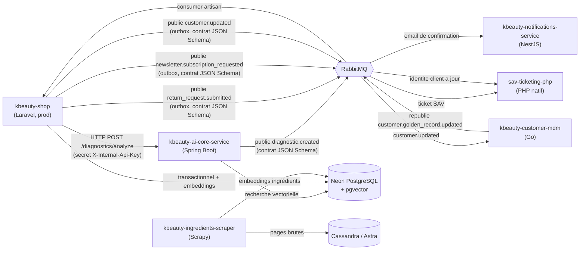

← [Retour au sommaire](README.md)

# 0. Portefeuille de projets — écosystème kbeauty

Vue d'ensemble des dépôts qui composent l'écosystème, pour un lecteur qui arrive sans
contexte. Le détail architectural est dans [01 — Vue d'ensemble](01-vue-ensemble.md) et
[14 — Modélisation SI (C4)](14-phase0-modelisation.md).

## En une phrase

Une **boutique e-commerce K-beauty en production** (`kbeauty-shop`), autour de laquelle gravitent,
à titre d'exercice de montée en compétence MIAGE, un **microservice d'IA** (`kbeauty-ai-core-service`),
un **robot d'extraction de données marché** (`kbeauty-ingredients-scraper`), une application **SAV**
connectée via RabbitMQ (`sav-ticketing-php`), un **microservice de notifications** connecté via
RabbitMQ (`kbeauty-notifications-service`), un **service de référentiel client unique / MDM** en Go
(`kbeauty-customer-mdm`) et une **infra locale partagée** (`kbeauty-ecosystem`).

## Les dépôts

| Dépôt | Rôle | Stack | Statut | Hébergement |
|---|---|---|---|---|
| **`kbeauty-shop`** | Produit réel : catalogue, panier, checkout Stripe, back-office, page diagnostic | PHP 8.5 · Laravel 13 · Inertia · React · TypeScript · Tailwind v4 · PostgreSQL (Neon) · Redis · Horizon | 🟢 en production, ~108 features livrées | Laravel Cloud |
| **`kbeauty-ai-core-service`** | Analyse vision de la photo de peau + matching vectoriel d'ingrédients | Java 21 · Spring Boot 3.4 · Hibernate/JPA · RabbitMQ · Resilience4j | 🟢 déployé en continu | Azure App Service (+ CloudAMQP pour RabbitMQ) |
| **`kbeauty-ingredients-scraper`** | Extraction quotidienne de catalogues d'ingrédients INCI (sources publiques, `robots.txt` respecté) | Python 3.12 · Scrapy · cassandra-driver · pgvector | 🟢 conteneurisé, cron cloud | Azure Container Apps Jobs (registre : Azure Container Registry) |
| **`sav-ticketing-php`** | Gestion de tickets SAV, retours boutique reçus via RabbitMQ | PHP 8.5 natif (sans framework) · MariaDB | 🟢 intégré ([doc 20](20-integration-sav-rabbitmq.md)), désactivé par défaut en prod | Railway envisagé (doc 20 §8), pas encore fait |
| **`kbeauty-notifications-service`** | Envoi des notifications transactionnelles (email, puis SMS/push), découplé du monolithe | Node 24 · NestJS · `amqp-connection-manager`/`amqplib` · Ajv · `node:sqlite` · Resend | 🟢 intégré ([doc 21](21-notifications-service.md)), flux vérifié de bout en bout, désactivé par défaut en prod | Railway envisagé (doc 21 §7), pas encore fait |
| **`kbeauty-customer-mdm`** | Référentiel client unique (golden record) : centralise les mises à jour d'identité client et les repousse aux systèmes avals | Go 1.27 · `amqp091-go` · `modernc.org/sqlite` · `jsonschema/v5` | 🟢 intégré ([doc 22](22-mdm-golden-record.md)), flux vérifié de bout en bout, désactivé par défaut en prod | Railway envisagé (doc 22 §7), pas encore fait |
| **`kbeauty-ecosystem`** | `docker-compose` de l'infra locale mutualisée | RabbitMQ · Cassandra · SonarQube · Valkey | 🟢 utilisé pour le dev | WSL Ubuntu |

## Comment ils se parlent

- **Synchrone** : `kbeauty-shop` appelle `kbeauty-ai-core-service` en HTTP server-to-server,
  authentifié par un secret partagé (`X-Internal-Api-Key`, *fail-closed*). Réponse dans la requête.
- **Asynchrone** : `kbeauty-ai-core-service` publie `diagnostic.created` sur RabbitMQ ; un contrat
  **JSON Schema versionné** ([`contracts/`](https://github.com/NF31/kbeauty-ai-core-service/tree/main/contracts)) garantit
  que producteur (Java) et consommateur (`ConsumeDiagnosticCreatedEventsCommand`, PHP) ne divergent
  pas ; message non conforme → `nack` sans requeue.
- **Données partagées** : la base Neon héberge à la fois le transactionnel de la boutique, les
  embeddings d'ingrédients (`shop_ingredient_embeddings`, `uniikon_ingredient_embeddings`) et les
  diagnostics anonymisés. Cassandra ne stocke que les données de marché scrapées.

## Où lire la suite

| Sujet | Document |
|---|---|
| Architecture système (C4), processus métier (BPMN), UML, backlog | [14 — Modélisation SI](14-phase0-modelisation.md) |
| Vue d'ensemble narrative de l'écosystème | [01 — Vue d'ensemble](01-vue-ensemble.md) |
| Persistance polyglotte (qui écrit quoi, où) | [02 — Bases de données & flux](02-bases-donnees.md) |
| Contrat d'événement RabbitMQ ↔ Laravel | [12 — Contrat RabbitMQ](12-contrat-rabbitmq-laravel.md) |
| Diagnostic vision réel (Claude) | [13 — Diagnostic vision](13-diagnostic-vision-laravel.md) |
| Référentiel client unique / MDM (urbanisation SI) | [22 — MDM golden record](22-mdm-golden-record.md) |
| Déploiement multi-cloud (Azure, CloudAMQP, Astra) | [15 — Phase 6 déploiement](15-phase6-deploiement-azure.md) |
| Séquencement des phases | [ROADMAP](ROADMAP.md) |
| Architecture du produit `kbeauty-shop` seul | `ARCHITECTURE.md` du dépôt `kbeauty-shop` (privé) |
| Périmètre fonctionnel `kbeauty-shop` | `FEATURES.md` du dépôt `kbeauty-shop` (privé) |

> **Cadre** : `kbeauty-ai-core-service`, `kbeauty-ingredients-scraper`, `kbeauty-customer-mdm` et
> `kbeauty-ecosystem` sont
> un **exercice pédagogique** (préparation Master MIAGE — ingénierie des processus métier). Ils se
> branchent en périphérie du produit sans en être un prérequis : si le microservice est éteint, la
> page diagnostic dégrade proprement et la boutique fonctionne normalement.
