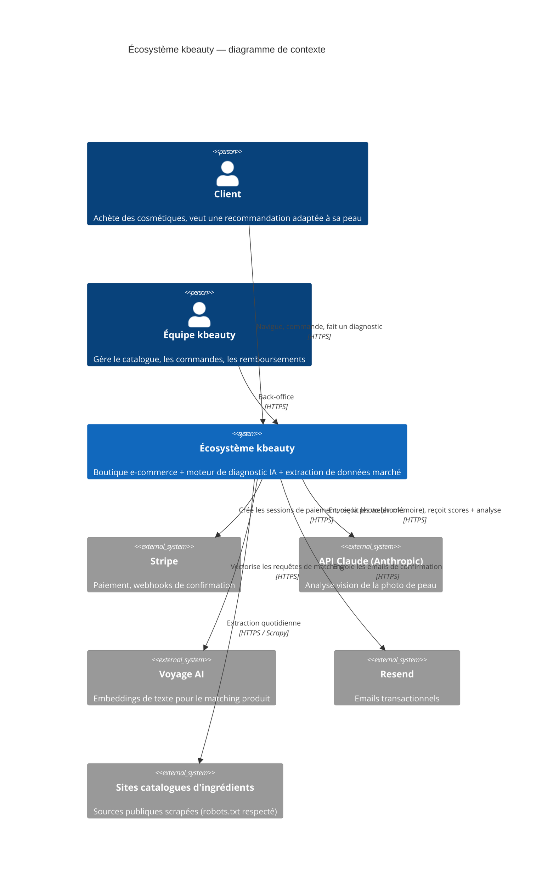
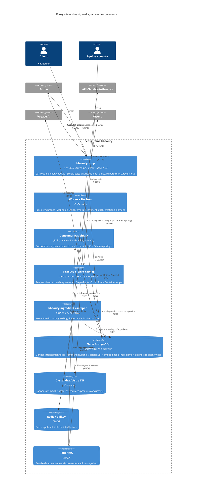
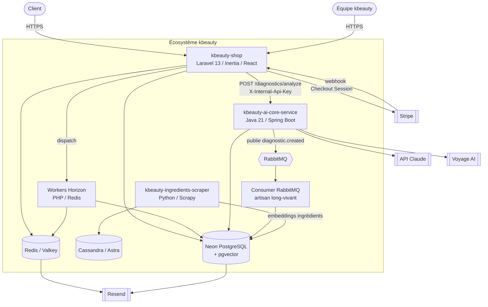
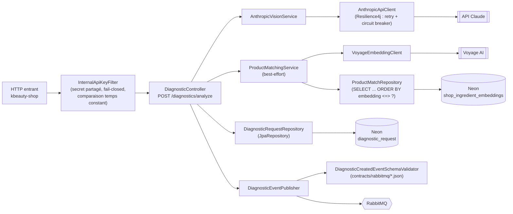
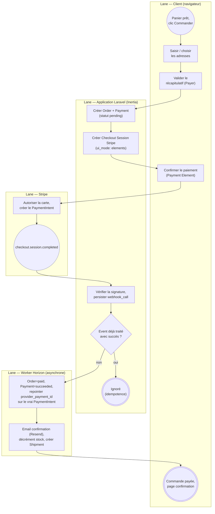
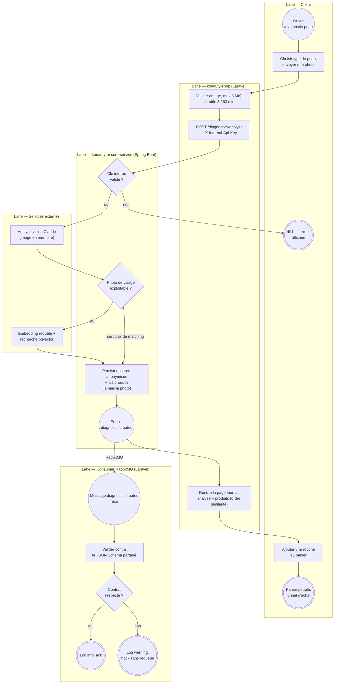
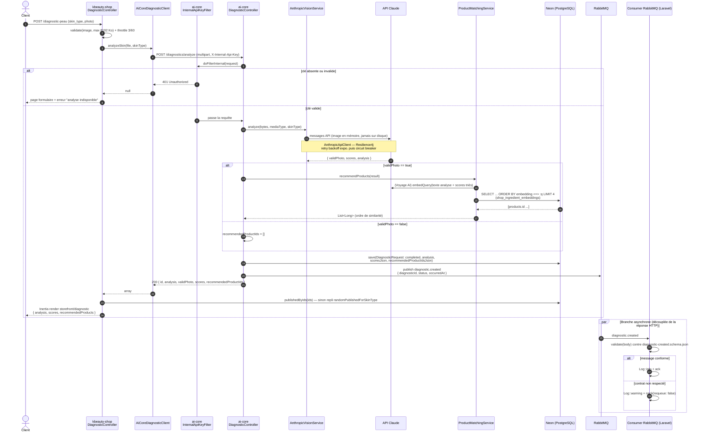
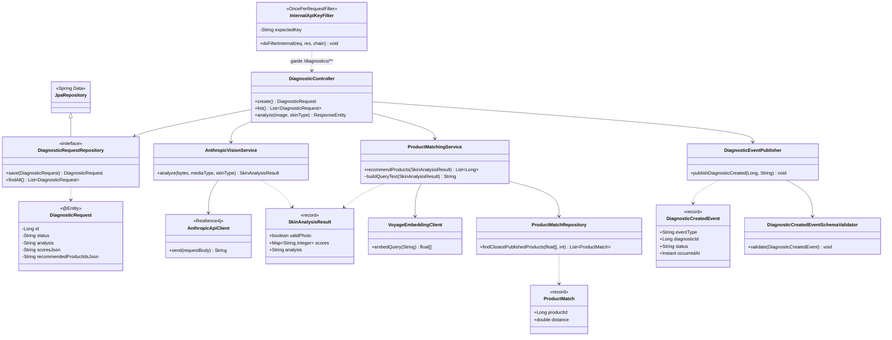
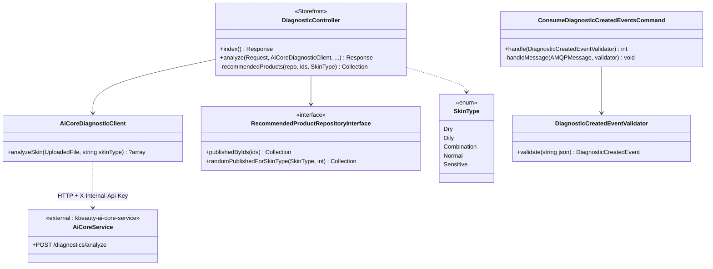

← [Retour au sommaire](README.md)

# 14. Phase 0 — Cadrage & modélisation du SI

> Fondation d'urbanisation demandée par la [ROADMAP](ROADMAP.md#phase-0--cadrage-j1--1-semaine) et
> jamais posée jusqu'ici (tout a été codé d'abord). C'est le livrable le plus attendu côté MIAGE :
> il documente le **processus métier** (BPMN 2.0), la **structure logicielle** (UML) et
> l'**architecture système** (modèle C4) de l'écosystème distribué déjà construit aux Phases 1 à 5,
> puis en tire un **backlog priorisé** pour le MVP « diagnostic connecté au panier ».
>
> Les diagrammes décrivent l'état **réellement en place** dans le code (au 2026-09-04), pas une
> cible. Chaque section renvoie aux classes concernées pour rester vérifiable.

## Sommaire

1. [Outillage](#1-outillage-extensions-vs-code)
2. [Modèle C4 — architecture système](#2-modèle-c4--architecture-système)
3. [BPMN 2.0 — processus métier](#3-bpmn-20--processus-métier)
4. [UML — structure & dynamique](#4-uml--structure--dynamique)
5. [Backlog — MVP « diagnostic connecté au panier »](#5-backlog--mvp-diagnostic-connecté-au-panier)
6. [Traçabilité modèle ↔ code](#6-traçabilité-modèle--code)

---

## 1. Outillage (extensions VS Code)

Fichiers de diagrammes versionnés avec le code, pas d'outil SaaS. Les extensions sont déclarées
dans `.vscode/extensions.json` à la racine de l'espace de travail (`~/projects/`, hors dépôt —
`.vscode/` est gitignore côté `kbeauty-shop`) : VS Code propose de les installer à l'ouverture du
dossier.

| Besoin | Format | Extension | Rendu GitHub | Pourquoi |
|---|---|---|---|---|
| C4, séquence, classes | Mermaid dans le `.md` | `bierner.markdown-mermaid` *(preview locale ; GitHub rend nativement)* | ✅ natif | texte diffable, zéro binaire, revue en PR |
| BPMN 2.0 | `.bpmn` (XML standard OMG) | `bpmn-io.vs-code-bpmn-io` | ❌ (aperçu dans l'IDE seulement) | vrai BPMN 2.0, importable Camunda Modeler / bizagi |
| Retouche visuelle libre | `.drawio.svg` | `hediet.vscode-drawio` | ✅ (c'est un SVG) | si besoin d'un export image propre pour un rapport |

Les deux processus BPMN sont fournis comme fichiers éditables :

- [`diagrams/tunnel-achat-stripe.bpmn`](diagrams/tunnel-achat-stripe.bpmn)
- [`diagrams/diagnostic-peau-async.bpmn`](diagrams/diagnostic-peau-async.bpmn)

Ils s'ouvrent **rendus** dans l'extension bpmn-io (clic droit → *Open With… → BPMN Editor*). Le
layout est généré automatiquement (lignes = lanes, colonnes = étapes) et peut être réorganisé à la
souris ; la version Mermaid ci-dessous sert de rendu de secours lisible directement dans GitHub.

> **Génération** : [`diagrams/gen_bpmn.py`](diagrams/gen_bpmn.py) produit les deux `.bpmn` (avec
> layout + DI) à partir d'une liste de nœuds/flux Python — `python3 diagrams/gen_bpmn.py`. Modifier
> un processus = éditer la liste et régénérer, ou retoucher le `.bpmn` à la souris dans bpmn-io.
> Les `.bpmn` sont vérifiés au parsing (`bpmn-moddle`, 0 warning) et les 9 blocs Mermaid de cette
> page par `@mermaid-js/mermaid-cli`.

---

## 2. Modèle C4 — architecture système

### Niveau 1 — Contexte

Qui utilise le système, et à quels systèmes externes il est relié.

### Niveau 2 — Conteneurs

Les unités déployables et leurs dépendances de données. Trois dépôts Git distincts
(`kbeauty-shop`, `kbeauty-ai-core-service`, `kbeauty-ingredients-scraper`) + l'infra partagée
(`kbeauty-ecosystem`).

> Si le rendu C4 ne s'affiche pas (version de Mermaid trop ancienne), voici la même vue en
> `flowchart`, toujours rendue :

### Niveau 3 — Composants (`kbeauty-ai-core-service`)

Découpage interne du microservice Java. Voir le [diagramme de classes](#diagramme-de-classes--cœur-de-kbeauty-ai-core-service) pour les attributs.

---

## 3. BPMN 2.0 — processus métier

**Légende** : `(cercle fin)` événement de début · `(cercle épais)` événement de fin ·
`(cercle double)` événement intermédiaire (message) · `<losange>` passerelle exclusive (XOR) ·
`[rectangle]` tâche · les bandes horizontales sont des **lanes** (qui fait quoi).

### 3.1 Processus A — Tunnel d'achat et paiement Stripe

Existant `kbeauty-shop` (`ARCHITECTURE.md` §4 du dépôt `kbeauty-shop`, privé).
Point clé : la commande ne passe à `paid` **que** sur réception du webhook Stripe côté serveur,
jamais sur le retour navigateur. Le webhook est dédupliqué (idempotence) et rejouable.

Fichier éditable : [`diagrams/tunnel-achat-stripe.bpmn`](diagrams/tunnel-achat-stripe.bpmn)

### 3.2 Processus B — Diagnostic de peau connecté au panier

Circuit synchrone (HTTP `kbeauty-shop` → `kbeauty-ai-core-service`) **plus** une branche
asynchrone (RabbitMQ) consommée séparément. Contraintes : la photo n'est **jamais** persistée
(RGPD), l'appel inter-service exige le secret `X-Internal-Api-Key`, le matching produit est
*best-effort* (une panne Voyage AI ne fait pas échouer le diagnostic).

Fichier éditable : [`diagrams/diagnostic-peau-async.bpmn`](diagrams/diagnostic-peau-async.bpmn)

---

## 4. UML — structure & dynamique

### Diagramme de séquence — analyse d'un diagnostic

De l'envoi du formulaire au rendu de la page, branche asynchrone incluse. Reflète
`Storefront\DiagnosticController::analyze`, `AiCoreDiagnosticClient`, le `DiagnosticController`
Java et `ConsumeDiagnosticCreatedEventsCommand`.

### Diagramme de classes — cœur de `kbeauty-ai-core-service`

### Diagramme de classes — frontière côté `kbeauty-shop`

---

## 5. Backlog — MVP « diagnostic connecté au panier »

Objectif du MVP : **un client peut, depuis la boutique, faire analyser une photo de sa peau et
recevoir des produits kbeauty-shop pertinents qu'il ajoute au panier**. Format des stories :
*En tant que … je veux … afin de …*. Estimation en points (suite de Fibonacci), vélocité cible
~20 pts / sprint de 2 semaines.

### Épics

| ID | Épic | Objectif |
|---|---|---|
| E1 | Socle microservice & contrat | Un Spring Boot qui lit/écrit Neon et publie un événement fiable |
| E2 | Analyse vision | Transformer une photo en scores + texte, sans jamais la stocker |
| E3 | Matching produit | Relier le résultat du diagnostic au catalogue réel |
| E4 | Parcours client | Page diagnostic → panier, dans le monolithe Inertia |
| E5 | Robustesse & conformité | Auth inter-service, RGPD, résilience, idempotence |
| E6 | Observabilité & industrialisation | Contrat OpenAPI, CI, déploiement |

### User stories

| ID | Story | Épic | Pts | Sprint | Definition of Done |
|---|---|---|---|---|---|
| US1 | En tant que dev, je veux un endpoint `POST /diagnostics` qui persiste une ligne en base Neon, afin d'avoir un socle vérifiable | E1 | 3 | 1 | `curl` → ligne visible dans Neon ; test JUnit vert |
| US2 | En tant que dev, je veux publier un événement `diagnostic.created` sur RabbitMQ à la création, afin de découpler les traitements aval | E1 | 5 | 1 | message visible dans la file ; `@RabbitListener` de test le loggue |
| US3 | En tant qu'architecte, je veux un contrat **JSON Schema versionné** partagé pour cet événement, afin que producteur et consommateur ne divergent pas | E1/E5 | 5 | 1 | schéma dans `contracts/` ; publication rejetée si non conforme ; `check-sync.sh` |
| US4 | En tant que client, je veux envoyer une photo + mon type de peau depuis `/diagnostic-peau`, afin de lancer une analyse | E4 | 5 | 1 | page Inertia ; validation `image`, max 8 Mo ; `throttle:3,60` |
| US5 | En tant que client, je veux que ma photo ne soit **jamais stockée**, afin que ma vie privée soit respectée | E2/E5 | 3 | 2 | image lue en mémoire (`getBytes()`), aucun `transferTo` ; test le prouve ; mention RGPD dans la doc |
| US6 | En tant que client, je veux une analyse (scores + texte type dermatologue) à partir de ma photo, afin de comprendre l'état de ma peau | E2 | 8 | 2 | appel API Claude ; `SkinAnalysisResult{validPhoto, scores, analysis}` persisté anonymisé |
| US7 | En tant que client qui envoie une photo inexploitable, je veux un message clair plutôt qu'un faux résultat, afin de ne pas être induit en erreur | E2 | 3 | 2 | `validPhoto=false` → pas de scores, pas de matching, message explicatif |
| US8 | En tant qu'exploitant, je veux que l'appel `kbeauty-shop → ai-core` exige un secret partagé, afin que le service ne soit pas appelable publiquement | E5 | 3 | 2 | `InternalApiKeyFilter` sur `/diagnostics/**` ; fail-closed si clé vide ; comparaison temps constant ; 401 testé |
| US9 | En tant que client, je veux des **produits kbeauty-shop réels** adaptés à mon diagnostic, afin de pouvoir les acheter | E3 | 8 | 3 | embeddings catalogue (`products:embed-ingredients`) ; recherche pgvector ; ids renvoyés dans l'ordre de similarité |
| US10 | En tant que client, je veux quand même des recommandations si le moteur de matching est en panne, afin que la page reste utile | E3/E5 | 3 | 3 | matching *best-effort* (liste vide sur erreur) ; repli `randomPublishedForSkinType` côté Laravel |
| US11 | En tant que client, je veux ajouter une routine recommandée au panier en un clic, afin d'enchaîner sur l'achat | E4 | 5 | 3 | bouton « ajouter au panier » → `CartService` ; panier peuplé ; redirige vers le tunnel |
| US12 | En tant qu'exploitant, je veux que l'appel vision soit protégé par retry + circuit breaker, afin d'absorber les incidents Anthropic | E5 | 5 | 3 | Resilience4j sur `AnthropicApiClient` ; test d'ouverture du circuit |
| US13 | En tant que consommateur d'événements, je veux rejeter sans requeue un message non conforme au contrat, afin de ne pas boucler à l'infini | E5 | 3 | 3 | `nack(requeue:false)` + `Log::warning` ; test avec payload invalide |
| US14 | En tant que dev intégrateur, je veux un contrat **OpenAPI/Swagger** de `ai-core`, afin de consommer l'API sans lire le code | E6 | 5 | 4 | Springdoc ; Swagger UI accessible ; schéma commité |
| US15 | En tant qu'équipe, je veux une CI qui lance Pest + JUnit + scan Sonar au push, afin de ne pas régresser | E6 | 8 | 4 | GitHub Actions vert sur PR ; badge ; seuil qualité Sonar |
| US16 | En tant qu'exploitant, je veux `ai-core` déployé sur Azure Container Apps, afin qu'il ne dépende plus d'un poste local | E6 | 8 | 4 | image Docker ; déploiement ; URL privée consommée par `kbeauty-shop` |

### Découpage en sprints

| Sprint | Thème | Stories | Pts | Incrément livré |
|---|---|---|---|---|
| **1** (S1–S2) | Socle event-driven + entrée du parcours | US1, US2, US3, US4 | 18 | `curl` / formulaire → ligne Neon → événement contractualisé sur RabbitMQ |
| **2** (S3–S4) | Analyse vision réelle & sécurisée | US5, US6, US7, US8 | 17 | photo → scores + texte, non stockée, service non appelable publiquement |
| **3** (S5–S6) | Matching produit & bouclage panier | US9, US10, US11, US12, US13 | 19 | diagnostic → vrais produits → panier ; résilient aux pannes externes |
| **4** (S7–S8) | Industrialisation | US14, US15, US16 | 21 | API documentée, CI, service déployé hors poste local |

> **État réel au 2026-09-04** : Sprints 1 à 3 **livrés** (Phases 1–5 + axes hors programme). Sprint 4
> ouvert : US14/US15/US16 correspondent exactement aux points restants
> ([ROADMAP](ROADMAP.md) Phase 2 dernier item + Phase 6). Le backlog est donc rétro-documenté pour
> les 3 premiers sprints et prospectif pour le 4ᵉ — ce qui est assumé : Phase 0 a été faite après
> le code, pas avant.

---

## 6. Traçabilité modèle ↔ code

| Élément du modèle | Où c'est dans le code |
|---|---|
| BPMN A — création Order/Payment `pending` | `App\Http\Controllers\Storefront\CheckoutController::pay` → `PlaceOrder`, `ProcessCheckoutPayment` |
| BPMN A — confirmation par webhook + idempotence | `App\Http\Controllers\Webhooks\StripeWebhookController` → `ProcessStripeWebhookJob` (dédup sur `payload->id`, `webhook_calls`) |
| BPMN A — traitement asynchrone (email, stock, Shipment) | Jobs Horizon déclenchés par le webhook (`ARCHITECTURE.md §4`) |
| BPMN B — validation & throttle | `routes/storefront.php` (`throttle:3,60,storefront-diagnostic`), `Storefront\DiagnosticController::analyze` |
| BPMN B — appel inter-service authentifié | `App\Services\AiCoreDiagnosticClient` (header `X-Internal-Api-Key`) ↔ `config/InternalApiKeyFilter.java` |
| BPMN B — analyse en mémoire, jamais stockée | `service/AnthropicVisionService.java`, entité `DiagnosticRequest` (aucun champ image) |
| BPMN B — photo inexploitable | `SkinAnalysisResult.validPhoto` → `DiagnosticController.analyze` (Java) + `Storefront\DiagnosticController` (Laravel) |
| BPMN B — matching best-effort + repli | `matching/ProductMatchingService.java` (catch → `List.of()`), `Storefront\DiagnosticController::recommendedProducts` (repli aléatoire) |
| BPMN B — publication d'événement contractualisée | `amqp/DiagnosticEventPublisher.java` + `DiagnosticCreatedEventSchemaValidator` + `contracts/rabbitmq/diagnostic-created.schema.json` |
| BPMN B — consommation + rejet sans requeue | `App\Console\Commands\ConsumeDiagnosticCreatedEventsCommand` + `DiagnosticCreatedEventValidator` |
| Séquence — recherche vectorielle | `matching/ProductMatchRepository.java`, table `shop_ingredient_embeddings` (`php artisan products:embed-ingredients`) |
| Classes — entité JPA | `entity/DiagnosticRequest.java` |
| C4 conteneurs — bus d'événements | `config/RabbitMQConfig.java` (Java) ↔ `config('rabbitmq')` (Laravel), déclarations idempotentes des deux côtés |

Voir aussi : [01 — Vue d'ensemble](01-vue-ensemble.md), [12 — Contrat RabbitMQ ↔ Laravel](12-contrat-rabbitmq-laravel.md),
[13 — Diagnostic vision](13-diagnostic-vision-laravel.md), [ROADMAP](ROADMAP.md).
